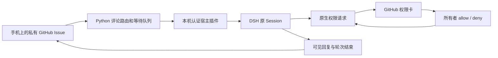

# 架构

Python 负责 GitHub、持久化状态、去重、任务排队和结果发布。插件装在持有原会话的 DSH Host 内，通过 `sessionController` 续接原会话。宿主没有外网监听端口、通用 shell 执行接口或权限配置写入接口。

`approval/request` 回调仅在已连接会话且监听器心跳有效时持有请求；其结果为 `allowed-once` 或 `rejected`。权限 ID 由插件生成，DSH 仍自行记录原生审批审计。请求取消、宿主重启和超时不能转成允许。心跳过期时委托原来的本机确认链。

模型切换避开会保存全局默认值的 `sessionController.selectModel`：验证路由后调用 `controller.agents.selectForNextRequest`。该接口不可用时明确失败，不降级成全局写入。

GitHub 评论 ID 转成确定性的 DSH `requestId`，提交状态先保存，依靠宿主原生请求去重恢复。完成追踪必须先匹配该 `requestId` 对应的用户消息，再读其轮次内助手回复和 `turn/end`。发布评论使用固定标记核对丢失回执，避免重复结果。

`.runtime/` 保存运行状态、备份和历史镜像，`config.json` 保存任务仓库及路径。宿主发现与随机令牌在 `$DSH_HOME/dsh2github/endpoint.json`。公开源码不含上述文件。
